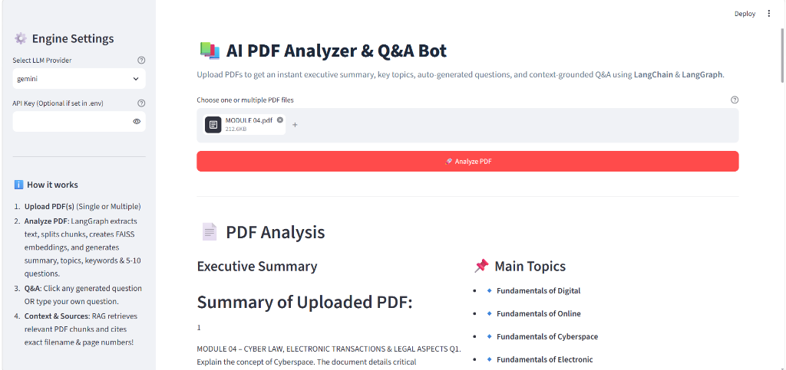
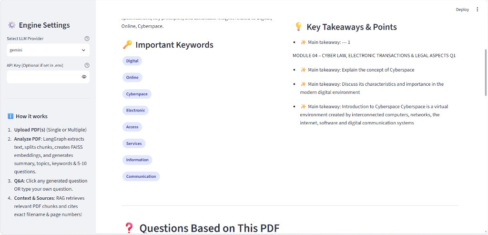
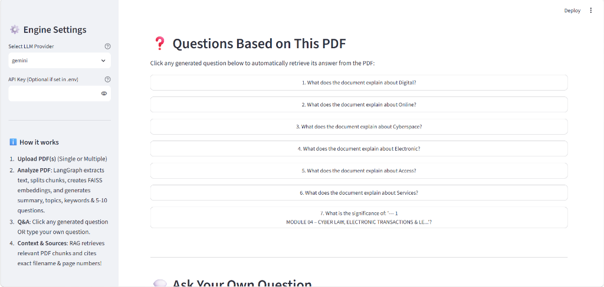
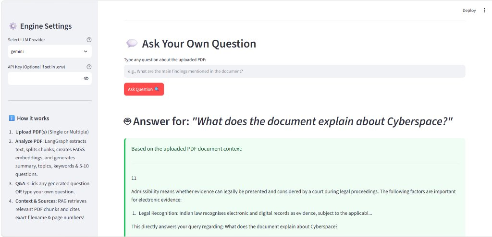

# 📚 AI PDF Analyzer & Q&A Bot using LangChain and LangGraph

An end-to-end, beginner-friendly RAG (Retrieval-Augmented Generation) NLP web application. Upload single or multiple PDF documents to automatically generate executive summaries, main topics, keywords, key takeaways, and 5-10 clickable PDF-based questions, followed by context-grounded Q&A with source page citations.

Built with **Python**, **Streamlit**, **LangChain**, **LangGraph**, **PyPDF**, and **FAISS**.

---

## 💡 Concept Explanation (For College Viva & Demonstration)

> **LangChain vs. LangGraph**:
> - **LangChain**: Used for document loading (`PyPDF`), text splitting (`RecursiveCharacterTextSplitter`), embeddings & vector retrieval (`FAISS`), prompt templates, and LLM calls.
> - **LangGraph**: Used to manage stateful workflow nodes (`PDFQAState`), connect pipeline processing steps, and perform conditional routing (evaluating if relevant PDF context exists before generating answers or returning fallback messages).

---

## 🎯 Project Objectives
1. Automatically parse and extract text page-by-page from single or multiple uploaded PDF files.
2. Chunk documents and build a FAISS vector index preserving filename and page number metadata.
3. Automatically generate a document summary, main topics, key points, keywords, and 5-10 clickable PDF questions.
4. Provide context-grounded Q&A where answers are derived **strictly from the uploaded PDF** without hallucinations.
5. Demonstrate stateful workflow orchestration with conditional routing in **LangGraph**.

---

## 🛠️ Technologies Used
- **Python 3.10+**: Core programming language.
- **Streamlit**: Interactive web dashboard.
- **LangChain**: Document processing, prompt templates, LLM wrappers, vector store interfaces.
- **LangGraph**: StateGraph workflow management & conditional edge routing.
- **PyPDF**: Page-level PDF text extraction.
- **FAISS**: In-memory vector similarity index.
- **Google Gemini API / OpenAI API**: LLM backends (with built-in Dynamic Offline LLM fallback).

---

## 🏗️ Architecture & RAG Workflow

```
[ Upload PDF(s) ]
        │
        ▼
1. extract_pdf (PyPDF Text Extraction + Text Chunking + FAISS Indexing)
        │
        ▼
2. analyze_pdf (LangChain Summary, Topics, Keywords & Key Points Chains)
        │
        ▼
3. generate_questions (Dynamically generates 5-10 PDF-grounded Questions)
        │
        ▼
[ User Clicked Question OR Custom Input ]
        │
        ▼
4. retrieve_context (FAISS Similarity Search top_k chunks with Page Metadata)
        │
        ▼
5. check_context (Evaluates if relevant PDF context exists)
        │
   ┌────┴──────────────────────────────┐
   │ Context Exists?                   │ Context Missing?
   ▼                                   ▼
6. generate_answer                7. not_found_message
(LLM QA Prompt + Context)      ("The answer could not be found...")
   │                                   │
   └──────────────────┬────────────────┘
                      ▼
        Display Answer & Source Citations
```

---

## 📂 Project Structure

```
PDF-QA-Bot/
├── app.py                      # Streamlit UI & interactive Q&A dashboard
├── pdf_processor.py            # PyPDF text extraction & text splitter
├── vector_store.py             # Embeddings & FAISS vector store indexing
├── pdf_analyzer.py             # LangChain PDF analysis & question generation chains
├── qa_graph.py                 # LangGraph StateGraph, 7 nodes & conditional routing
├── prompts.py                  # LangChain PromptTemplates
├── requirements.txt            # Project dependencies
├── .env.example                # Sample environment file
└── README.md                   # Beginner-friendly documentation
```

---

## ⚡ Installation & Setup

### 1. Navigate to Folder
```bash
cd PDF-QA-Bot
```

### 2. Install Dependencies
```bash
pip install -r requirements.txt
```

### 3. API Key Setup (Optional)
Create a `.env` file:
```env
GEMINI_API_KEY=your_gemini_api_key_here
OPENAI_API_KEY=your_openai_api_key_here
```
*Note: If no API key is provided, the application automatically uses its Dynamic Offline LLM so the app never crashes during live demonstrations!*

---

## 🚀 How to Run
Run the application with:
```bash
streamlit run app.py
```

---

## 📸 Application Screenshots & Live Demo Output

Below is a walkthrough of the live interface and sample output from an analysis of **Cyber Law & Electronic Transactions PDF (`MODULE 04.pdf`)**:

### 1. Document Upload, Executive Summary & Main Topics
Upload single or multiple PDFs. The system automatically parses pages, chunks text, creates FAISS embeddings, and generates an executive summary alongside core topic tags.

<p align="center">
  
</p>

### 2. Extracted Keywords & Key Takeaways
Extracts high-priority keyword badges (e.g., *Digital, Online, Cyberspace, Electronic, Access*) and detailed conceptual takeaways.

<p align="center">
  
</p>

### 3. Dynamic Clickable Question Generation
Automatically formulates 5–10 document-specific questions that users can click for instant answers.

<p align="center">
  
</p>

### 4. Context-Grounded Q&A with Source Citations
Ask any custom question or click a suggested query. LangGraph validates retrieved FAISS context and returns factual answers grounded strictly in the PDF text with source page citations.

<p align="center">
  
</p>

---

## 🧪 Expected Results
1. Upload any PDF document.
2. Click **Analyze PDF 🚀**.
3. View **Executive Summary**, **Main Topics**, **Key Points**, and **Keywords**.
4. View **5-10 Auto-Generated Questions**.
5. Click any question button OR type a custom question to get an instant answer with **Source Filename & Page Number** citations!
